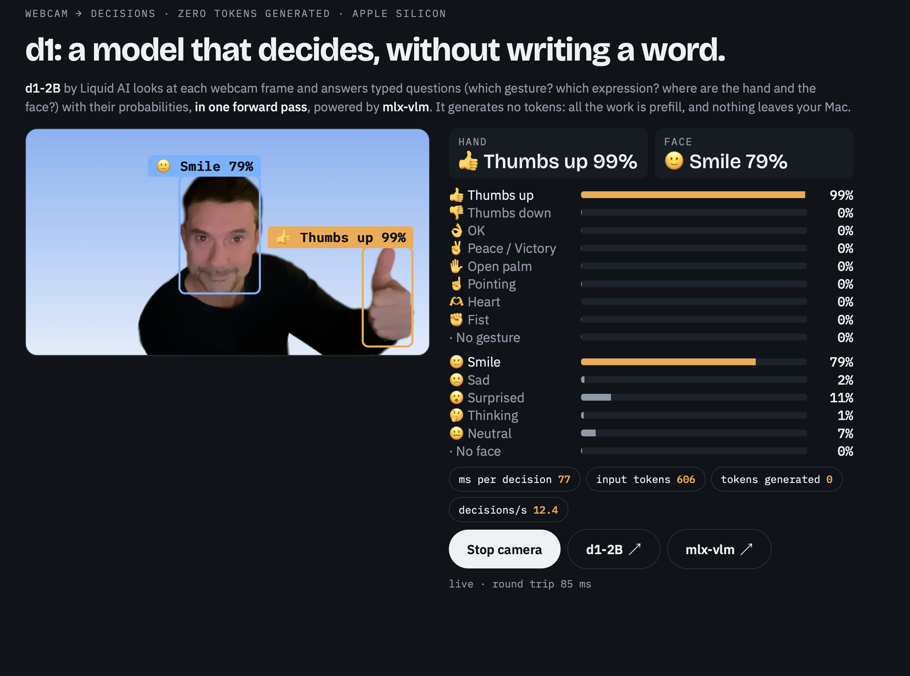

# mlx-d1-gestures-rs

Pure-Rust + Apple Silicon **MLX** port of [`ivanfioravanti/mlx-d1-gestures`](https://github.com/ivanfioravanti/mlx-d1-gestures): your webcam in, live hand gesture, facial expression, and normalized bounding boxes out—in **one zero-token forward pass** on `127.0.0.1` with zero Python, `uv`, or PyTorch dependencies.



## Why Pure Rust + MLX?

- **Zero Python / Zero `uv` Runtime:** Directly executes [`LiquidAI/d1-2B-MLX-8bit`](https://huggingface.co/LiquidAI/d1-2B-MLX-8bit) (LFM3-VL 14-layer vision encoder + GELU multimodal projector + 24-layer LFM3 hybrid ShortConv / GQA language backbone) on Metal unified memory via `mlx-rs`.
- **Single-Pass `set` Attention (`0` Output Tokens):** Packs all four typed questions (`hand`, `face`, `hand_box`, `face_box`) behind a single encoded image prefix using `d1` bidirectional state + intra-question `set` attention masks.
- **Candidate-Only Head & Plan Caching:** Instead of projecting hidden states over all `128,000` vocabulary rows, slot hidden states gather and multiply **only** the candidate option/thousandth rows (`9` hand codes, `6` face codes, `yes/no` presence, and `0..999` thousandth edge bins), caching packed token layouts and `SetMasks` across live `640×480` webcam frames.
- **Exact Calibration & 4D Halton Box Confidence:** Faithfully implements `calibration.json` bucket temperatures, monotone knot-table probability calibration (`found:box`, `box`), CDF median/interpolated edge decoding, and deterministic 512-draw 4D Halton `IoU >= 0.5` box confidence.
- **100% Local Privacy:** Binds strictly to `127.0.0.1` with a dedicated single-flight GPU worker thread so frames never leave your Mac and concurrent browser requests never thrash Metal memory.

---

## Quick Start

Requires macOS on Apple Silicon (`aarch64-apple-darwin`) and Rust `1.87+`.

```bash
# Build & run with Apple Silicon Accelerate / AMX (works out of the box):
cargo run --release -- --open

# Or with full Metal GPU shaders (requires Xcode MetalToolchain: `xcodebuild -downloadComponent MetalToolchain`):
cargo run --release --features metal -- --open
```

On first launch, `mlx-d1-gestures` checks `~/.cache/huggingface/hub` and automatically downloads `LiquidAI/d1-2B-MLX-8bit` (~2.2 GB) with a progress bar if not already cached.

### One-Shot CLI Frame Decision

Classify any local `.jpg` / `.png` / `.webp` image directly from the terminal without starting the web server:

```bash
cargo run --release -- decide path/to/frame.jpg
```

---

## HTTP API & Configuration

Wire-compatible drop-in replacement for upstream `decide.py` + `start.sh`:

| Endpoint | Method | Description |
| :--- | :--- | :--- |
| `/` or `/index.html` | `GET` | Embedded dark-mode live webcam UI with mirrored bounding boxes & probability bars |
| `/status` | `GET` | Health & readiness probe (`{"model": "...", "ready": true}`) |
| `/run` | `POST` | Raw JPEG/PNG body (`<= 4 MiB`) → `{"answers": {...}, "usage": {"input_tokens": n, "output_tokens": 0}, "ms": ...}` |
| `/questions` | `GET` / `POST` | Inspect or dynamically update the active System-One `QUESTIONS` schema at runtime |

### Environment Variables & Flags

| Variable | CLI Flag | Default | Description |
| :--- | :--- | :--- | :--- |
| `DECIDE_PORT` | `--port` | `8049` | Loopback port (`127.0.0.1:<port>`) |
| `DECIDE_MODEL` | `--model` | `LiquidAI/d1-2B-MLX-8bit` | HuggingFace repo ID or local checkpoint directory |
| `D1_VISION_MAX_PIXELS` | — | `1638400` | Override maximum input pixel budget before `smart_resize` |
| `DECIDE_DEVICE` | — | `gpu` | Set to `cpu` to force MLX CPU/AMX execution |

---

## Architecture

```text
Browser Webcam (640x480 JPEG)
   │  POST /run (127.0.0.1:8049)
   ▼
Axum Loopback Server ──► Single-Flight GPU Worker Thread
                              │
                              ├─► image_proc: cap_pixels + smart_resize + merged spatial-temporal patchify
                              ├─► VisionTower (14 layers: VisionConv 3x3 depthwise + Axial 2D RoPE Attention + SwiGLU)
                              ├─► MultiModalProjector (LayerNorm -> 4x spatial merge -> Linear -> GELU -> Linear)
                              ├─► Lfm3Backbone (24 layers: ShortConv k=7 + Partial-RoPE GQA + Sandwich RMSNorm + SetMasks)
                              └─► Candidate-Only Readout + Calibration Knots + 512-Draw 4D Halton Box IoU
```

## License

MIT OR Apache-2.0. Adapted in pure Rust from [`ivanfioravanti/mlx-d1-gestures`](https://github.com/ivanfioravanti/mlx-d1-gestures) and Liquid AI's `d1-2B` / `mlx-vlm` System-One specification.
